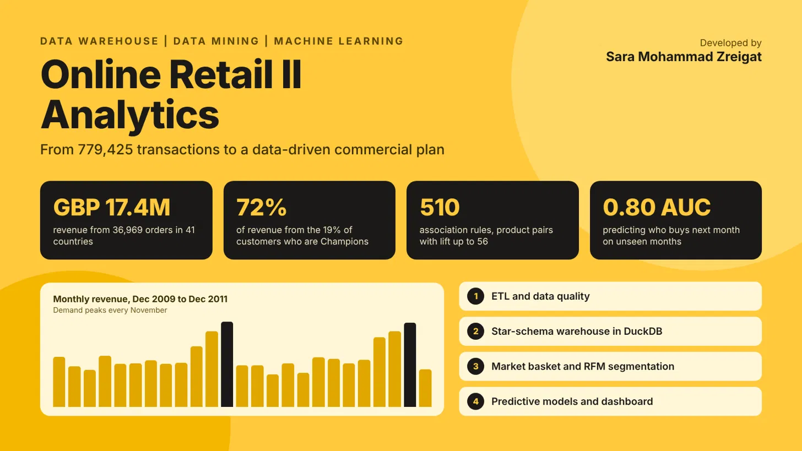

An end-to-end analytics project on 779,425 transactions from a UK online giftware wholesaler (December 2009 to December 2011). The data was cleaned and validated, modelled as a star-schema data warehouse in DuckDB, and analysed with data mining and machine learning. The dataset covers GBP 17.4M of revenue across 41 countries. The analysis found that 19% of customers (the Champions segment) produce 72% of revenue, discovered 510 product association rules with lift up to 56, and predicts which customers will buy next month with a ROC-AUC of 0.80. Monthly revenue shows a strong seasonal pattern that peaks every November.
